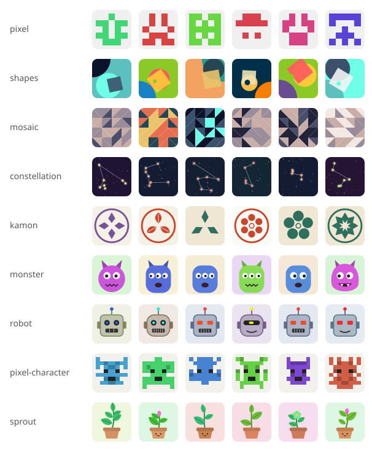

# iconsprout

Deterministic SVG avatars & identicons from any seed — GitHub-style pixels, geometric patterns and cute illustrations.
Zero dependencies. Works on Web, React Native / Expo, Node and Edge runtimes.



## Packages

| Package | Use |
| --- | --- |
| `iconsprout` | Core. Generates an SVG string / data URI / element tree |
| `@iconsprout/react` | `<IconSprout />` for React DOM |
| `@iconsprout/react-native` | `<IconSprout />` for React Native & Expo (via `react-native-svg`) |

## Install

```sh
pnpm add iconsprout                       # core only
pnpm add @iconsprout/react                # React (DOM)
pnpm add @iconsprout/react-native react-native-svg   # React Native / Expo
```

## Usage

```ts
import { createAvatar, monster } from "iconsprout";

const avatar = createAvatar(monster, { seed: "kosuke", size: 64, radius: 50 });
avatar.toString();  // "<svg ...>"
avatar.toDataUri(); // for 
```

```tsx
import { IconSprout, pixel } from "@iconsprout/react"; // or "@iconsprout/react-native"

<IconSprout variant={pixel} seed="kosuke" size={48} radius={12} />
```

## Styles

| Style | Type |
| --- | --- |
| `pixel` | GitHub-style 5×5 mirrored grid |
| `shapes` | Bauhaus-like circles and squares |
| `mosaic` | 4×4 triangle tiles |
| `monster` | Body, eyes, horns and mouth parts |
| `robot` | Head, eyes (LED / lens / visor), grill |
| `pixelCharacter` | 8×8 pixel-art character |

## Options

| Option | Type | Default | |
| --- | --- | --- | --- |
| `seed` | `string` | — | Same seed → same image |
| `size` | `number` | `64` | px |
| `radius` | `number` | `0` | Corner radius in a 100×100 box (`50` = circle) |
| `colors` | `string[]` | built-in palettes | Override colors (shape stays the same) |
| `title` | `string` | — | Accessible label |

## Custom styles

```ts
import { createAvatar, defineStyle, h } from "iconsprout";

const dot = defineStyle({
  name: "dot",
  render: ({ rng, palette }) => {
    const [bg, fg] = palette(2);
    return [
      h("rect", { width: 100, height: 100, fill: bg }),
      h("circle", { cx: 50, cy: 50, r: rng.int(15, 40), fill: fg }),
    ];
  },
});

createAvatar(dot, { seed: "kosuke" }).toString();
```

Styles draw in a 100×100 coordinate space and return an element tree, so one implementation renders everywhere.
Use `ctx.id()` for any `id` so multiple avatars on a page never collide.

## Development

```sh
pnpm install
pnpm test      # node:test, no extra deps
pnpm build
pnpm preview   # regenerate preview.svg
pnpm changeset # describe your change for the next release
```

## License

MIT
